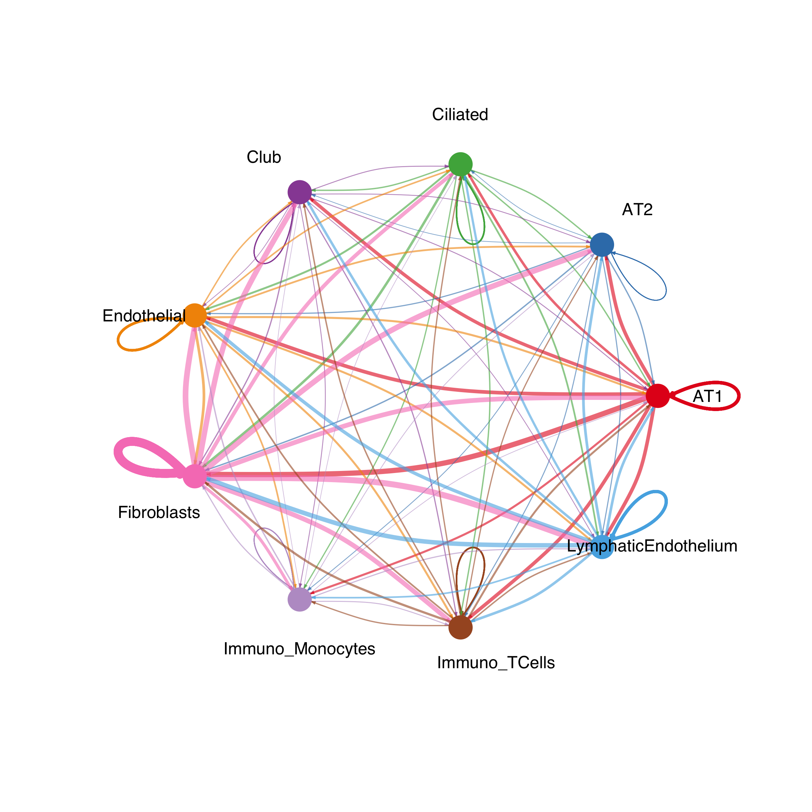
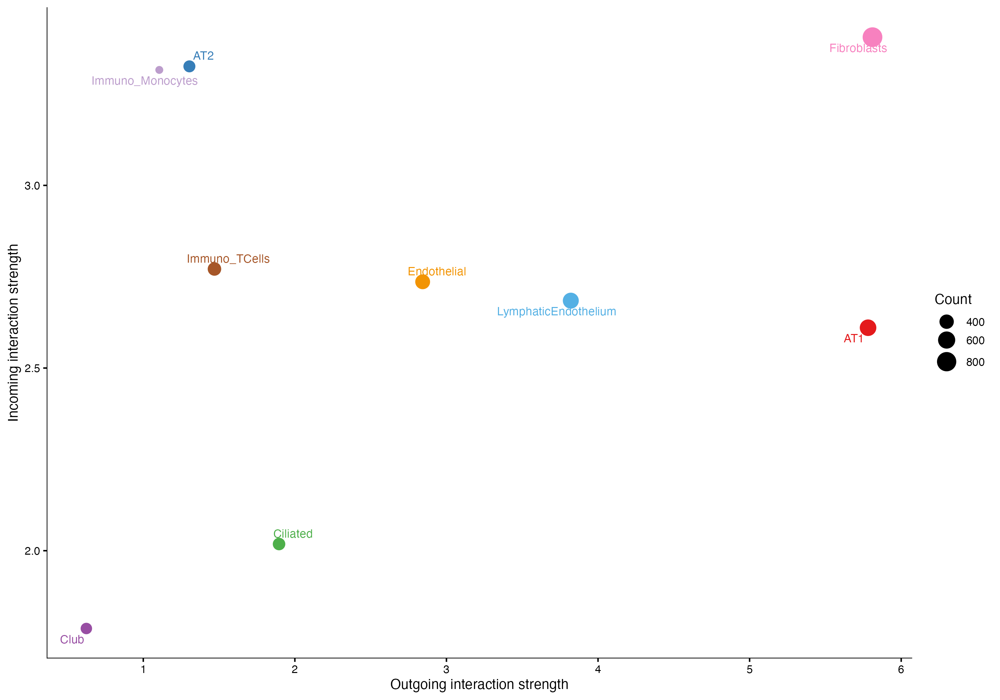
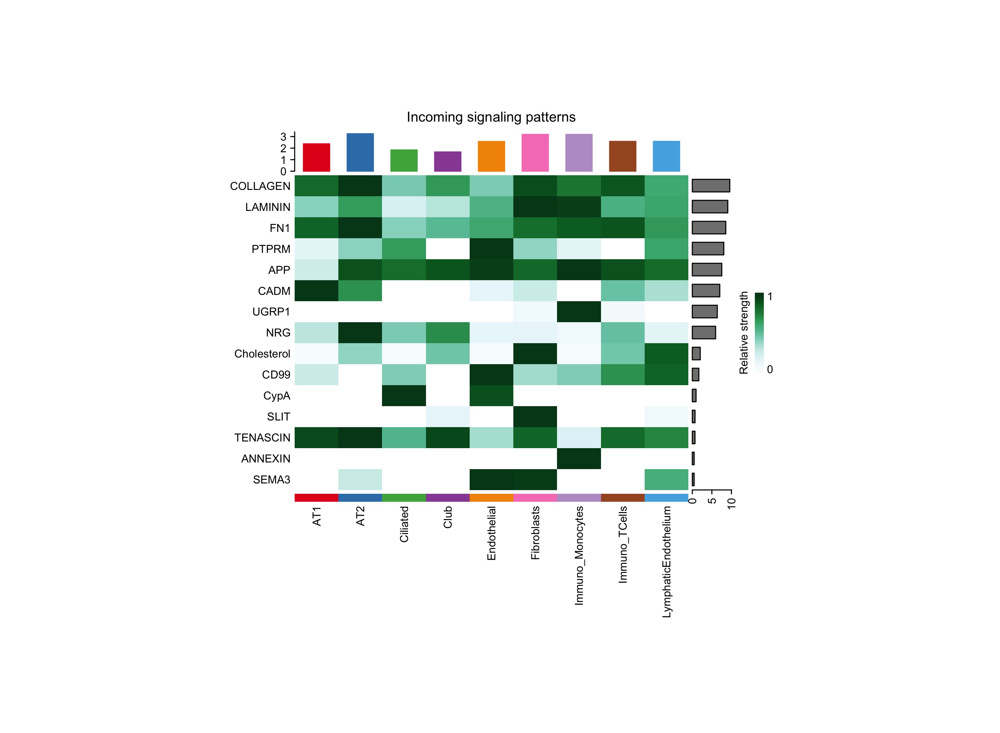
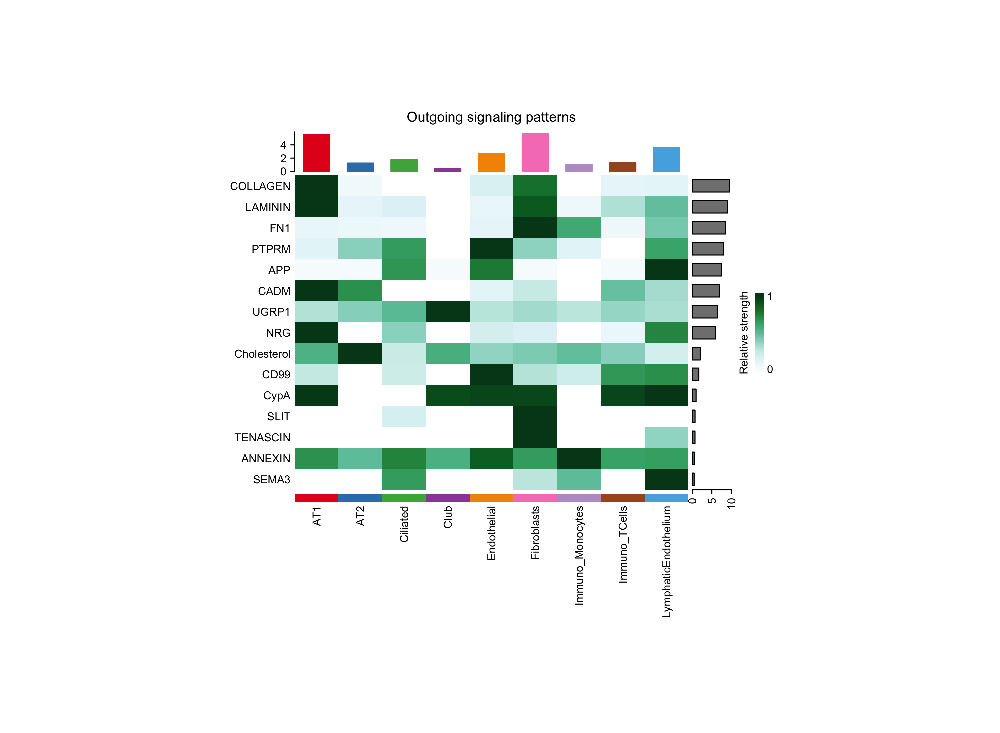
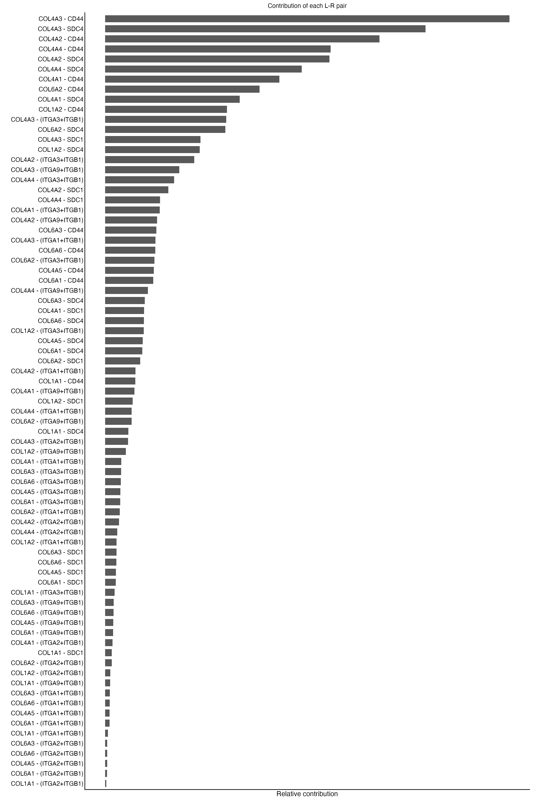
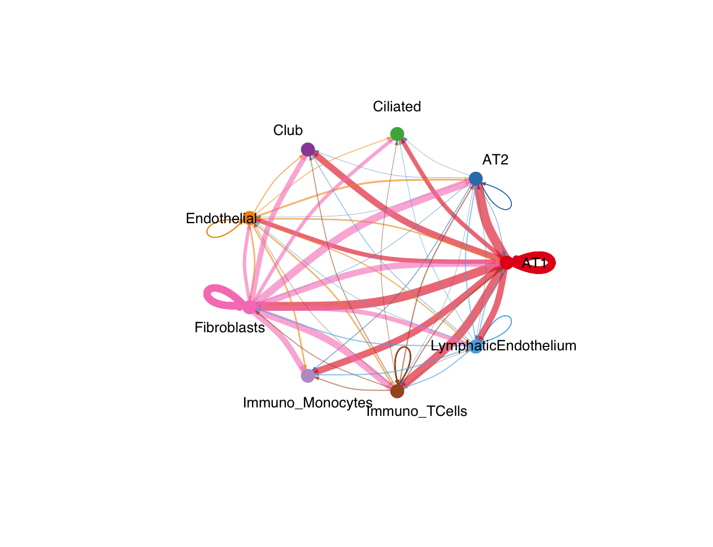

# CellChat Analysis of Human Lung Cell Communication

## 1. Project Overview

This project uses **CellChat**, an R package, to study possible communication between different cell populations in human lung tissue using single-cell/nucleus gene expression data.

### Research Question

What cell-cell communication patterns can be predicted between different cell populations in human lung tissue?

## 2. Data Source

The human lung dataset was obtained from Mendeley Data:

https://data.mendeley.com/datasets/7r2cwbw44m/2

The dataset contains gene expression counts and metadata for 39,778 lung nuclei.

The analysis used a balanced subset of 1,800 nuclei, with 200 nuclei selected from each of the nine cell types.

## 3. Method

CellChat was used to predict possible communication between cell populations.

The analysis included:
- Identifying cell populations.
- Using the CellChat database to identify possible ligand-receptor interactions.
- Calculating communication probabilities.
- Identifying significant signalling pathways.
- Examining incoming and outgoing communication patterns.
- Visualising the predicted cell-cell communication network.

## 4. Results

The analysis identified:
- **9 cell types**
- **50 significant signalling pathways**
- **2,013 predicted cell-cell interactions**

The network visualisation showed predicted communication between different lung cell populations. The incoming and outgoing heatmaps helped examine differences in signalling patterns between cell types.

The analysis also examined COLLAGEN-related signalling.

These results suggest that different lung cell populations may participate in several communication pathways.

### Results figures

**1. Overall cell-cell communication network**

**2. Signalling roles of cell populations**

**3. Incoming signalling pathways**

**4. Outgoing signalling pathways**

**5. COLLAGEN signalling contribution**

**6. COLLAGEN signalling network**

## 5. Limitations

Only 1,800 nuclei were used instead of the complete dataset. Although the subset was balanced across the nine cell types, the results may differ if all nuclei are analysed.

CellChat predictions are based on gene expression and known molecular interactions. They do not prove that the predicted communication actually occurs. Experimental validation would be needed.

## 6. Project Files

- `CellChat_lung_analysis.R` – R analysis script.
- `CellChat_lung_results.rds` – Saved CellChat analysis object.
- `CellChat_overall_network.png` – Overall communication network.
- `CellChat_signaling_role_scatter.png` – Signalling role plot.
- `CellChat_incoming_heatmap_clear.png` – Incoming signalling heatmap.
- `CellChat_outgoing_heatmap_clear.png` – Outgoing signalling heatmap.
- `COLLAGEN_contribution.png` – COLLAGEN signalling contribution plot.
- `CellChat_key_results.txt` – Numerical summary.
- `CellChat_software_details.txt` – R software and package information.

## 7. Requirements

The analysis was performed using R 4.6.2.

Required R packages include:
- CellChat
- Seurat
- ggplot2
- ComplexHeatmap
- patchwork

Package versions will be recorded in `renv.lock`.

## 8. How to Run

1. Download the dataset from the Mendeley Data link above.
2. Place the count and metadata files in the project data folder.
3. Open `CellChat_Lung_Project.Rproj` in RStudio.
4. Install the required R packages.
5. Run `CellChat_lung_analysis.R`.

The raw count data is large and is not included in this repository.

## 9. Conclusion

This project demonstrates how CellChat can be applied to human lung gene expression data to predict possible communication between cell populations. Using a balanced subset allowed the analysis to include equal numbers of nuclei from each cell type. The results provide a starting point for understanding cell-cell communication in lung tissue.
